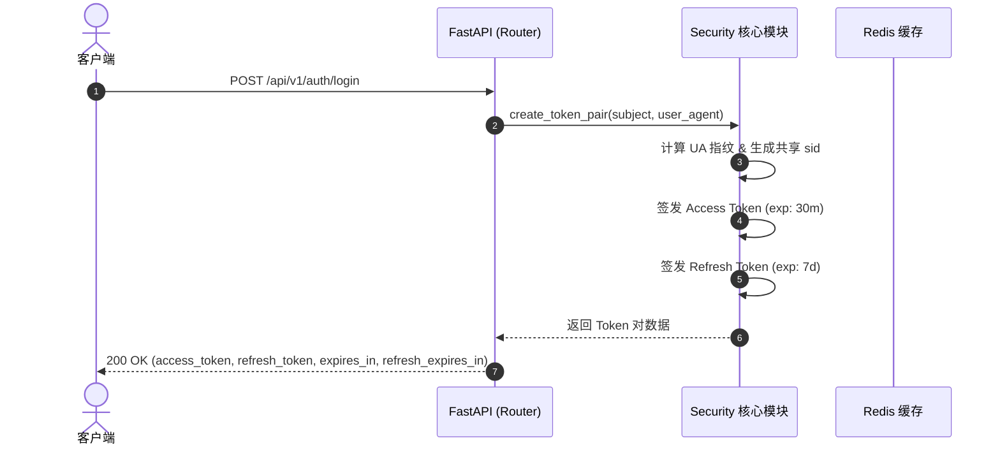
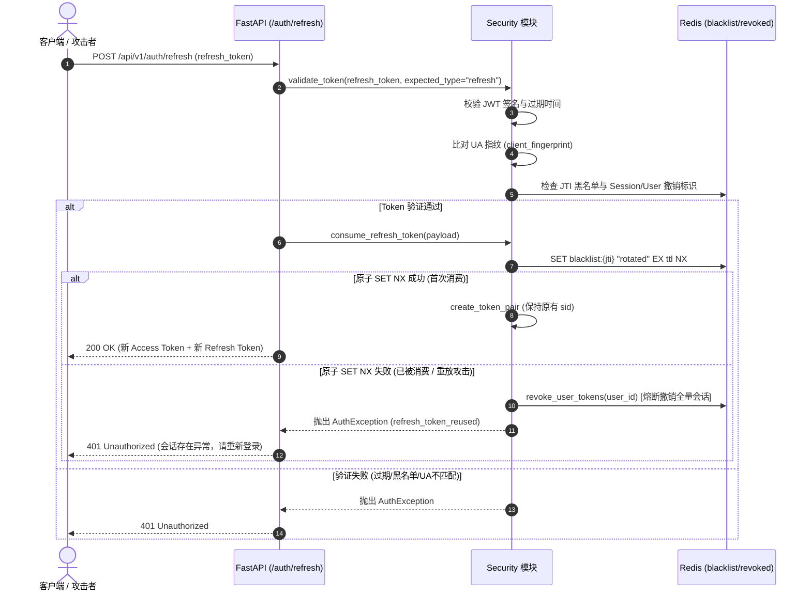

# 双 Token 刷新机制与 JWT 防重放技术文档

本文档详细介绍了本项目 (`fastapi-tp6`) 中集成的双 Token (Access Token + Refresh Token) 刷新机制、JWT 防重放攻击、客户端上下文指纹绑定以及 Redis 状态防护的技术实现架构。

---

## 1. 核心设计思想与架构

### 1.1 双 Token 分离
- **Access Token (短效)**：默认有效期 30 分钟。用于业务 API 请求认证，承载最少必须的 Payload。
- **Refresh Token (长效)**：默认有效期 7 天。仅用于在 `/api/v1/auth/refresh` 接口换发新的 Access Token 和 Refresh Token。

### 1.2 客户端指纹绑定 (Client Fingerprinting)
- 签发 Token 时计算客户端 `User-Agent` 的 SHA-256 不可逆哈希，并存入 JWT Claim 中的 `client_fingerprint` 字段。
- 每次校验 Token 时比对当前请求的 UA 指纹。如果指纹不一致（说明客户端环境改变或 Token 被窃取至异构环境），系统立即撤销该会话 (`sid`) 并抛出 `client_context_mismatch` 异常。

### 1.3 JWT 防重放攻击与原子轮换 (Atomic Token Rotation)
- 每次换发 Refresh Token 时，服务器会在 Redis 中使用原子指令 `SET kos:security:token_blacklist:{jti} rotated EX {ttl} NX`。
- 如果旧 Refresh Token 被**第二次使用**（说明发生了 Token 泄露或重放攻击），`SET NX` 将返回失败 (`False`)。
- 系统检测到 Refresh Token 被重复消费后，会立即触发**用户级安全熔断 (`revoke_user_tokens`)**，拉黑该用户当前签发的所有 Token，强制全量设备重新登录。

### 1.4 Redis 状态 Fail-Closed 安全策略
- 认证黑名单与撤销状态强依赖 Redis 存储。若 Redis 服务故障或连接断开，系统采取 **Fail-Closed (失败关闭)** 策略，拒绝访问并返回 `503 Auth State Unavailable`，防止黑名单防护失效。

---

## 2. 业务时序与流程图

### 2.1 双 Token 登录签发流程



### 2.2 无感续期与 Refresh Token 轮换防重放流程



---

## 3. Redis Key 设计规范

| Redis Key 前缀 | 说明 | 数据结构与值 | TTL 说明 |
| :--- | :--- | :--- | :--- |
| `kos:security:token_blacklist:{jti}` | Token 针对性黑名单 / 轮换标记 | `string` (`"1"` 或 `"rotated"`) | 与 Token 剩余过期时间保持一致 |
| `kos:security:session_revoked:{sid}` | 会话级撤销标识（撤销单次登录会话） | `string` (`"1"`) | 等于 `REFRESH_TOKEN_EXPIRE_DAYS` (7天) |
| `kos:security:user_token_valid_after:{user_id}` | 用户级全量撤销时间戳（熔断/修改密码） | `string` (`timestamp_ms`) | 等于 `REFRESH_TOKEN_EXPIRE_DAYS` (7天) |
| `kos:security:lock:{identifier}` | 账号登录失败锁定 | `string` (`"1"`) | 默认 2 小时 (7200s) |
| `kos:security:fail_count:{identifier}` | 账号登录连续失败计数 | `string` (`count`) | 15 分钟窗口 (900s) |
| `kos:security:nonce:{nonce}` | 防重放请求随机数 | `string` (`"1"`) | 2 * 时间窗口 (120s) |

---

## 4. 关键代码解析

### 4.1 原子 Refresh Token 轮换算法 (`app/core/security.py`)
```python
async def consume_refresh_token(payload: dict) -> bool:
    """原子消费 Refresh Token。False 表示已被使用或注销。"""
    redis = await _get_security_redis()
    result = await _redis_call(
        lambda: redis.set(
            f"{BLACKLIST_PREFIX}{payload['jti']}",
            "rotated",
            ex=_remaining_token_seconds(payload),
            nx=True,
        )
    )
    return bool(result)
```

### 4.2 客户端环境与撤销状态综合校验 (`validate_token`)
```python
async def validate_token(
    token: str,
    expected_type: str,
    user_agent: str,
) -> dict:
    # 1. 解码 JWT 签名与过期校验
    payload = decode_token(token)
    
    # 2. Token 用途与必填 Claim 校验
    if payload.get("token_type") != expected_type:
        raise _auth_error("token_type_invalid", "Token 用途不匹配")

    # 3. 客户端 UA 指纹哈希比对
    actual_fingerprint = get_client_fingerprint(user_agent)
    if not hmac.compare_digest(payload["client_fingerprint"], actual_fingerprint):
        await revoke_session_tokens(payload["sid"])
        raise _auth_error("client_context_mismatch", "客户端环境已变化，请重新登录")

    # 4. Redis 黑名单、会话撤销、用户撤销检查
    revoked = (
        await is_token_context_revoked(payload)
        if expected_type == "refresh"
        else await is_token_revoked(payload)
    )
    if revoked:
        raise _auth_error("token_revoked", "Token 已注销或已失效")

    return payload
```
